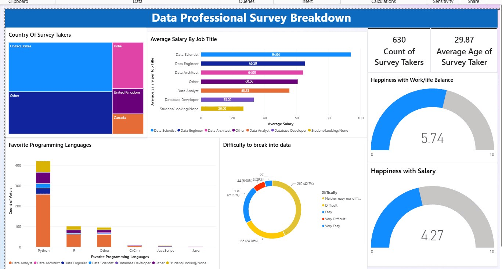

# Data Professional Survey Breakdown

I built this Power BI dashboard to visualize survey responses from 630 participants. The report brings together respondent demographics, compensation by role, programming language preferences, and experiences entering the data field.

## What the dashboard shows

| View | What it measures |
| --- | --- |
| Respondent profile | 630 survey responses, an average age of 29.87, and a breakdown by country |
| Compensation | Average salary by job title in the survey sample |
| Programming languages | Favorite languages by job title, with Python receiving the most votes overall |
| Entering the field | Respondents' ratings of how difficult it was to break into data |
| Job satisfaction | Average work–life balance satisfaction of 5.74/10 and salary satisfaction of 4.27/10 |

## How I presented the data

I used a treemap for country breakdown, bar charts for salary and language comparisons, a donut chart for difficulty ratings, and cards and gauges for summary metrics. The figures describe this survey sample and should be interpreted in that context.

**Tool** · Power BI Desktop

## Credits

Survey data and walkthrough by [Alex The Analyst](https://www.youtube.com/watch?v=pixlHHe_lNQ). Dashboard implementation by Ali Dana.
